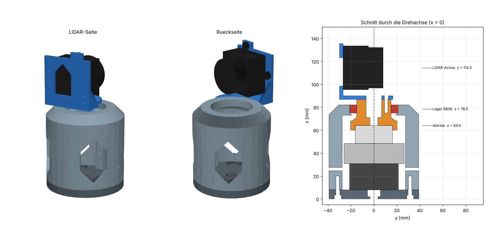

# Scankopf v3 – Stufe 2 (gelagerter Abtrieb)

Motor, Getriebe und Gehäuse stehen fest auf dem Stativ. Es drehen nur Nabe, LiDAR-Träger und STL27L.
Ein Rillenkugellager direkt unter dem Träger führt den Drehteil; das Getriebe überträgt das Drehmoment.
Die Scan-Ebene des STL27L (y = 0) enthält die Drehachse, der Sollwert des Achsversatzes ist 0 / 0.



## Teile (`out/*.stl`, `out/*.step`)

| Datei | Teil | Drucklage |
|---|---|---|
| `1_boden` | Scheibe Ø 78 × 8, Stativmutter 1/4", vier Eckpfosten als Motorführung | flach, Pfosten nach oben |
| `2_glocke` | Stator Ø 78 × 74 mit Lagersitz, vier Rippen, vier Fenster | kopfüber (Lagersitz auf dem Bett), ohne Stützen |
| `3_nabe` | Vierkant-Tasche 32,5 × 4 auf den Abtrieb, Zapfen Ø 29,9 für das Lager | Tasche nach unten (Brücke 32,5 mm) |
| `4_lidartraeger` | Winkel mit Lochbild STL27L (3 × M2), Fenster, zwei Rippen | stehend, Boden auf dem Bett |
| `passprobe_*` | Vierkant-Tasche, Lagersitz, Zapfen | zuerst drucken |

PETG, 0,2 mm, 4 Wände, 20–30 % Füllung. Drehende Druckteile zusammen höchstens 39 g (massiv gerechnet).

## Kleinteile

- 1 × Rillenkugellager 6806-2RS (30 × 42 × 7)
- 1 × Schraube 1/4"-20 UNC × 3/4" (19 mm), Zylinderkopf mit Innensechskant: Nabe → Abtrieb
- 1 × Mutter 1/4"-20 UNC (Stativmutter im Boden)
- 4 × M3 × 16 Boden → Glocke, 4 × M3 × 20 Motorklemmung, 3 × M3 × 12 Träger → Nabe (direkt in den Kunststoff)
- 3 × M2 × 8 mit Mutter für den STL27L

## Montage

1. Stativmutter in den Boden legen, Motor mit Getriebe zwischen die Eckpfosten stellen.
2. Nabe auf den Abtriebs-Vierkant, 1/4"-Schraube durch die Mitte anziehen.
3. Lager von oben in die Glocke drücken, Glocke über Motor und Nabe schieben (Zapfen gleitet ins Lager).
4. Glocke von unten mit 4 × M3 × 16 verschrauben. Erst danach die vier Klemmschrauben gegenüberliegend
   und nur bis zur Anlage anziehen – der Motor soll dort stehen bleiben, wo ihn das Lager hinführt.
5. Träger mit 3 × M3 × 12 auf den Zapfen, STL27L mit dem Sockel an die Rückwand (Stecker zur Seite der zwei Laschen).
6. Kabel in einer Schlaufe nach unten, Kabelbinder durch die zwei Löcher im Träger.

## Maße: gemessen, aus Dateien abgeleitet, zu prüfen

| Größe | Wert | Herkunft |
|---|---|---|
| STL27L Lochbild, Höhe, optische Ebene 27,0 mm | 46,8 / 31,92 / 34,8 | Datenblatt Abschnitt 5.1 |
| STL27L Sockel 38,1 mm, Lochlinie 10,3 mm von der Kante | ± 0,5 | aus der Datenblatt-Zeichnung abgegriffen |
| Abtriebs-Vierkant 32,3 × 5 mm, Mutter 1/4" 7,6 mm unter der Außenfläche | – | `gearbox kameraplatte.obj` (PiLiDAR-Hardware) |
| Getriebedeckel 52,3 mm, größter Radius 32,2 mm | – | `gearbox_deckel.obj` |
| `GEAR_STACK_H` Motorstirnfläche → Außenfläche Abtrieb | 33 mm | aus den Dateien abgeleitet, **nicht gemessen** |
| `MOTOR_L` | 23 mm | Typ 17HS4023 |

Der Zapfen lässt bei `GEAR_STACK_H` ± 4 mm zu (geprüft in `pruefen.py`). Liegt das Maß außerhalb von 29–37 mm,
den Parameter in `kopf_v3.py` ändern und neu erzeugen.

## Eigenschaften

- LiDAR-Achse 36 mm über der Lagermitte, Gesamthöhe 142 mm ab Stativplatte.
- Schatten nach unten: ± 43,6° um die Lotrechte (Glockenoberkante). Höher setzen verkleinert ihn, kostet aber Steifigkeit.
- Schwerpunkt der drehenden Druckteile 7 mm neben der Achse; bei 1,9 °/s ohne Bedeutung.

## Neu erzeugen und prüfen

```
pip install build123d trimesh shapely rtree matplotlib
python cad/kopf_v3.py      # STEP, STL, geometrie.json
python cad/pruefen.py      # Volumenkörper, Durchdringungen, Toleranz, Vorschau
```
